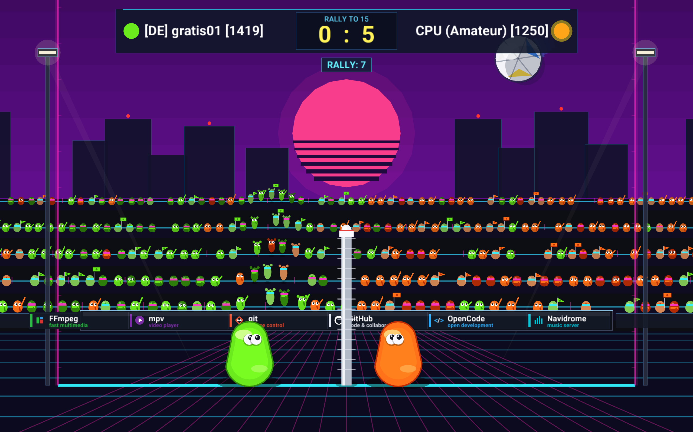

# Blobby Volley 3

Unofficial Rust rewrite and remaster of [danielknobe/blobbyvolley2](https://github.com/danielknobe/blobbyvolley2).



A fast, native, cross-platform head-to-head beach volleyball game: GPL-licensed, dependency-light,
and built on `macroquad` + `glam`. Everything from the original Blobby Volley 2 — the physics,
the bots, the sounds — has been ported, and everything around it has been rebuilt.

---

## What's New vs. Blobby Volley 2

### 8 Procedural Widescreen Arenas & Animated Stadium Crowds

Eight fully procedural venues, each with its own palette, skyline, and lighting:

1. **Copacabana Sunset** — layered sunset sky, low sun with bloom, drifting clouds, animated surf
   with foam crests, and swaying palms.
2. **Blobby Grand Arena (Stadium)** — floodlit tournament stadium with tiered stands.
3. **Neo Cyber Stadium** — synthwave sun, neon grid floor, pulsating laser net.
4. **Olympic Beach Stadium** — bright championship beach court with an Olympic-scale tribune.
5. **Classic Beach HD** — a crisp modern tribute to the original Blobby Volley beach.
6. **Alpine Peaks (Snow)** — snow-capped ridges, pine silhouettes, drifting snowfall.
7. **Magma Caldera (Volcano)** — glowing lava lakes, crater horizon, heat shimmer, embers.
8. **Orbital Station (Space)** — starfield, Earth curvature, solar arrays, containment court.

Adaptive aspect-ratio scaling covers **16:10, 16:9, and 21:9** without distortion. Floodlights,
boundary laser bars, and **team-loyal blob spectators** fill the stands — they wear scarves,
headbands, visors, and pennants, their eyes track the ball, they perform **"La Ola"** waves, and
they cheer on every point and on victory.

### Scrolling Perimeter Sponsor Boards

The boards surrounding the court scroll continuously and showcase popular open-source Craft apps
(sorted by GitHub stars) — **PhotoCraft, PdfCraft, FilmCraft, WordCraft, LightCraft, VectorCraft,
EffectCraft, CADCraft, GridCraft, DesignCraft, FigCraft, DeckCraft, SoundCraft** — alongside
**Arch Linux, Debian, Fedora, CachyOS, KDE Plasma, Rust, Godot, Blender, FFmpeg, mpv, Git,
OpenCode, Navidrome, and Neovim**, in the spirit of the original game's Linux distribution
banners.

### Adjustable Court Width & Live Ruler Visualizer

A continuous slider (default `800px`, up to the full screen borders) with **hold-to-repeat**
arrow buttons. A live world-space caliper/beacon preview shows exactly how wide the court will
be, and AI trajectories are recalculated for the chosen width so bots cover the space correctly.

### High-Ball Camera Choice

When the ball goes above the visible area, pick your preference:

- **Off-Screen Indicator** — altitude readout plus a vertical laser guide marking the ball's column.
- **Dynamic Zoom** — the camera pulls back smoothly to keep the ball in frame.

### Physics, Visuals & UX Polish

- **Continuous Collision Detection (CCD)** — no tunnelling at high ball speeds.
- **Spring-jelly blobs** — volume-preserving squash-and-stretch, gloss highlights, contact shadows.
- **Expressive eyes** — pupil tracking, blinking, reactions.
- **3D spinning volleyball** — multi-panel rotation, motion trails, impact VFX, confetti.
- **Modern (rally-point) & Classic (side-out) rules**, with configurable winning score
  (`5 / 10 / 15 / 21`).
- **Touch counter** resets when the ball crosses the net.
- **Sound Volume slider** (`0%–100%`) plus mute on `M`.
- **Full mouse & keyboard support**, with hold-to-repeat arrows and Backspace.
- **Instant local Rematch** directly from the Victory screen.

### 5-Tier Calibrated AI & CPU vs CPU

Five tiers calibrated to Glicko-2 baselines (`1000`–`2000`): **Novice, Amateur, Regular, Master,
Pro**. Each has its own reaction time, court coverage, spike selection, and recovery behaviour —
from gentle ground returns to diving panic saves and high-play corner spikes. You can also watch
**CPU vs CPU** matches.

### Ranked Matchmaking, Leaderboards & Profiles

- **Quick Match** with **Glicko-2** ratings and divisions from **Bronze I** up to **Grandmaster**.
- **Elo search range** — `Strict ±50`, `Balanced ±100`, `Wide ±250`, `Unrestricted`, with the
  window expanding by `+1/3` every 5 seconds while you wait.
- **Live challenge radar** showing nearby opponents and queue activity.
- **Cross-arena negotiation** — the server picks a deterministic consensus arena; press `Y` to
  accept, `N` to decline, or `Space` for a 50/50 deterministic coin flip.
- **Global Leaderboards** on `L`, with **Week / Month / Year** tabs.
- **250 country badges and flags** with type-ahead search (`GER` → Germany).
- **LAN UDP auto-discovery** on port `1235` — zero-config local play.
- **STUN NAT discovery** for direct peer-to-peer connections across the internet.
- **Optional HTTPS/HTTP registry** via the included Cloudflare Worker (`server/worker.js`).
- **In-game chat** on `T` or `C`.
- **Online forfeit handling** — disconnects and forfeits resolve cleanly without hanging matches.

---

## Controls

| Action | Player 1 | Player 2 |
|---|---|---|
| **Move Left** | `A` or `Left Arrow` (in 1P) | `Left Arrow` or `J` |
| **Move Right** | `D` or `Right Arrow` (in 1P) | `Right Arrow` or `L` |
| **Jump / Spike** | `W`, `Space`, or `Up Arrow` (in 1P) | `Up Arrow`, `I`, `Enter`, or `Right Shift` |

| Shortcut | Function |
|---|---|
| `T` / `C` | In-game chat (`Enter` sends, `Escape` cancels) |
| `Y` / `N` / `Space` | Accept / decline / coin-flip a cross-arena challenge |
| `L` | Global leaderboards |
| `M` | Mute / unmute audio |
| `Escape` or `P` | Pause / in-game menu |
| `F11` or `Alt+Enter` | Toggle fullscreen |
| `Up` / `Down` (or `W` / `S`) | Menu navigation |
| `Left` / `Right` (or clicking `<` / `>`) | Cycle a setting's value (hold to repeat) |
| `Enter` / `Space` / row click | Confirm and start |

Settings support direct mouse interaction: click the `<` / `>` arrows on any row — even one that
is not focused — or click the row body to confirm and immediately play.

---

## How to Build & Run

Requires a stable Rust toolchain. On Linux you also need ALSA, X11, and OpenGL headers
(`libasound2-dev libx11-dev libxi-dev libgl1-mesa-dev` on Debian/Ubuntu; `alsa-lib libx11 libxi`
on Arch).

### Quick Run

```bash
cargo run --release
```

### Run Tests

```bash
cargo test
```

### Build Release Artifacts

```bash
cargo build --release
```

The optimized binary is written to `target/release/blobby`.

### Packages

`packaging/build_packages.sh` produces a portable `.tar.gz`, a Debian `.deb`, and the Arch
`PKGBUILD` in `dist/`. Cross-platform release archives (Linux, Windows, macOS universal) are
built by `.github/workflows/release.yml`.

---

## License, Attribution & Trademarks

**Blobby Volley 3 is licensed under `GPL-3.0-or-later`.** The full text is in [`COPYING`](COPYING).

This project is an unofficial rewrite of **Blobby Volley 2**
(<https://github.com/danielknobe/blobbyvolley2>), which is licensed under **`GPL-2.0-or-later`**.
The original game design, physics constants and simulation (`PhysicWorld.cpp`,
`GameConstants.h`), Lua bot behaviours (`com_11.lua`, `reduced.lua`, `bot_api.lua`), and sound
effects (transcoded from `data/sounds/*.wav`) come from that project. Original authors:
**Jonathan Sieber, Daniel Knobe, Sven Rech, Erik Schultheis, Silvio Mummert, Richard Bertrand**,
and the Blobby Volley 2 contributors. The combined work is distributed under `GPL-3.0-or-later`
in accordance with GPLv2 Section 9. This project is not affiliated with or endorsed by the
upstream authors.

The optional matchmaking worker in `server/worker.js` is dual-licensed under
**`MIT OR Apache-2.0`**.

Bundled third-party assets keep their own licenses:

- **Roboto Bold** (`rust/assets/fonts/Roboto-Bold.ttf`) — Copyright Google LLC, `Apache-2.0`.
- **Craft app icons** (`rust/assets/sponsors/*.png`) — `MIT OR Apache-2.0`.
- **Rust crates** — permissive licenses recorded in `Cargo.lock` (MIT, Apache-2.0,
  BSD-3-Clause, Zlib, 0BSD, Unlicense).

See [`THIRD_PARTY_LICENSES.md`](THIRD_PARTY_LICENSES.md) for the complete attribution and license
breakdown.

**Trademark notice.** All third-party project, distribution, application, and product names,
logos, and icons shown in this repository, in the game UI, or on the in-game perimeter sponsor
boards — including the Craft apps, Arch Linux, Debian, Fedora, CachyOS, KDE Plasma, Rust, Godot,
Blender, FFmpeg, mpv, Git, OpenCode, Navidrome, and Neovim — are the trademarks or property of
their respective owners. They are used for identification and attribution only. Their use does
not imply any affiliation with, endorsement of, or sponsorship by those projects, nor does it
imply that they endorse Blobby Volley 3.
